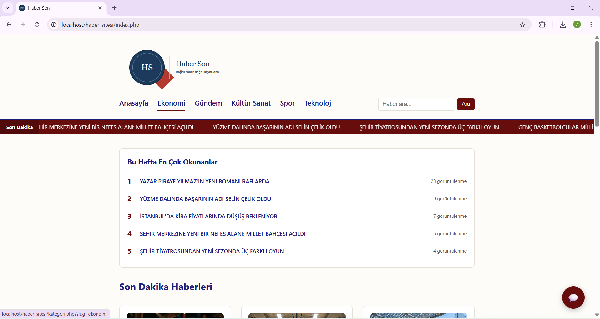
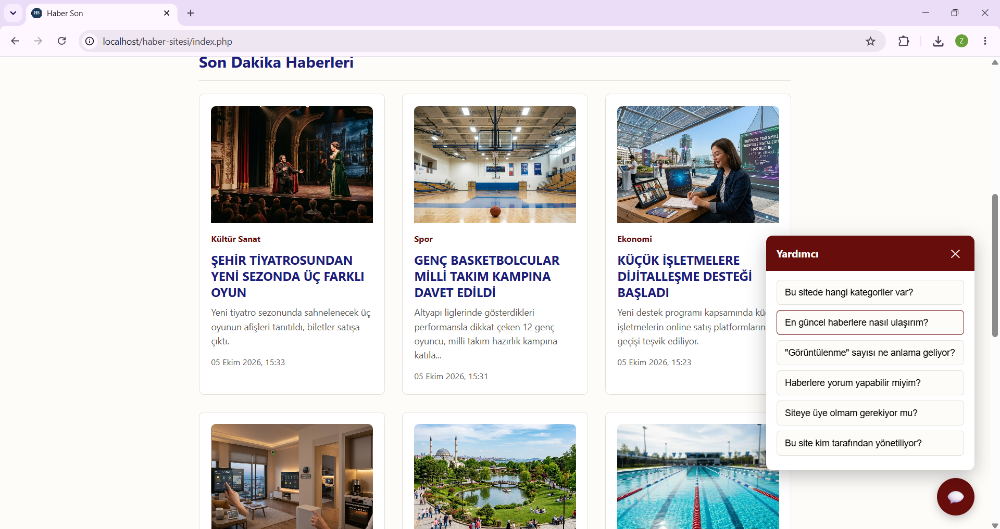
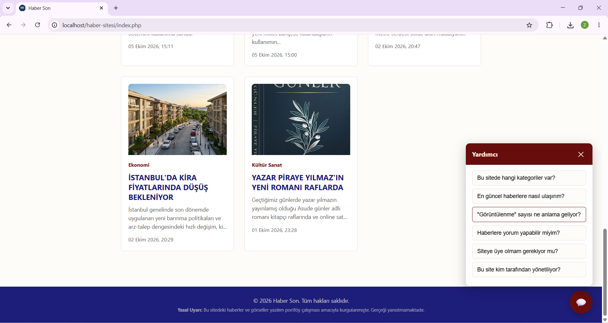
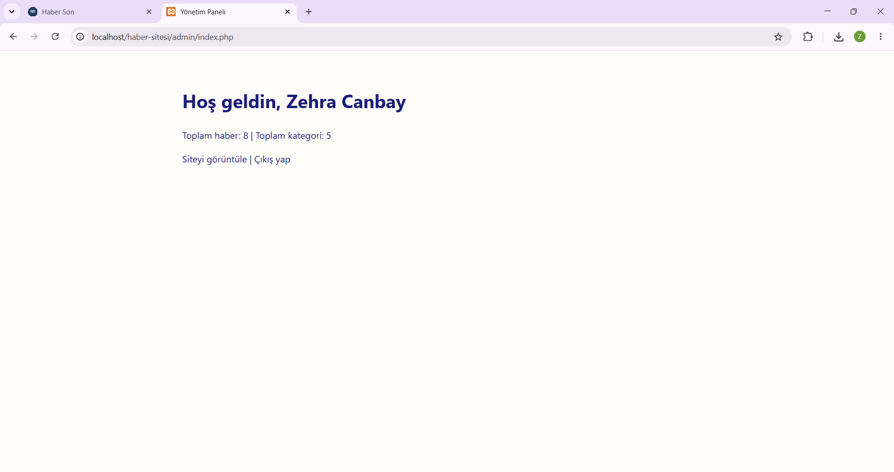

# Haber Son

Saf PHP ve MySQL ile geliştirilmiş, yönetim paneli üzerinden içeriği tamamen yönetilebilen bir haber platformu.




**Yönetim Paneli**


## İçindekiler

- [Özellikler](#özellikler)
- [Kullanılan Teknolojiler](#kullanılan-teknolojiler)
- [Klasör Yapısı](#klasör-yapısı)
- [Kurulum](#kurulum)
- [Güvenlik](#güvenlik)
- [İçerik Hakkında](#içerik-hakkında)

## Özellikler

### Genel Site

- Kategori bazlı haber listeleme ve filtreleme
- Görüntülenme sayacına sahip haber detay sayfaları
- Başlık ve özet üzerinden anlık arama
- Haftalık en çok okunan haberler bölümü
- Güncel haberleri gösteren kayan bilgi şeridi
- Sık sorulan sorular için etkileşimli yardım widget'ı
- Mobil ve masaüstü ekranlara uyumlu responsive tasarım
- Özel tasarlanmış hata (404) sayfası

### Yönetim Paneli

- Oturum tabanlı, güvenli kimlik doğrulama
- Haber ekleme, düzenleme ve silme işlemleri (tam CRUD desteği)
- Görsel yükleme ve otomatik dosya yönetimi
- Kategoriye göre filtreleme
- Taslak / yayında durum kontrolü

## Kullanılan Teknolojiler

| Katman | Teknoloji |
|---|---|
| Sunucu tarafı | PHP 8.2 |
| Veritabanı | MySQL (PDO, prepared statement'lar ile) |
| Ön yüz | HTML5, CSS3, Vanilla JavaScript |
| Sunucu ortamı | Apache (XAMPP) |

Herhangi bir framework veya harici kütüphane kullanılmadan, tamamen temel teknolojilerle geliştirilmiştir.

## Klasör Yapısı

```
haber-sitesi/
├── admin/              Yönetim paneli (kimlik doğrulama, haber yönetimi)
│   └── includes/
├── assets/
│   ├── css/             Stil dosyaları
│   ├── js/              JavaScript dosyaları
│   └── uploads/         Yüklenen haber görselleri
├── config/              Veritabanı bağlantısı ve genel yapılandırma
├── database/            SQL şema dosyası
├── includes/            Ortak bileşenler (header, footer, yardımcı fonksiyonlar)
├── index.php            Anasayfa
├── kategori.php         Kategori sayfası
├── haber.php            Haber detay sayfası
└── search.php           Arama sonuçları
```

## Kurulum

**Gereksinimler:** PHP 8.x, MySQL, Apache (XAMPP önerilir)

1. Projeyi klonla veya indir, XAMPP'ın `htdocs` klasörüne yerleştir.

2. `database/schema.sql` dosyasını phpMyAdmin üzerinden içe aktararak veritabanı şemasını oluştur.

3. `config/database.php` dosyasındaki bağlantı bilgilerini kendi ortamına göre düzenle:

   ```php
   private $host = 'localhost';
   private $db_name = 'haber_sitesi';
   private $username = 'root';
   private $password = '';
   ```

4. `admin/kurulum.php` adresine giderek ilk yönetici hesabını oluştur. Hesap oluşturulduktan sonra bu dosyanın silinmesi önerilir.

5. Siteye şu adreslerden erişilebilir:

   - Genel site: `http://localhost/haber-sitesi/index.php`
   - Yönetim paneli: `http://localhost/haber-sitesi/admin/login.php`

## Güvenlik

- Tüm veritabanı sorguları PDO prepared statement'lar ile yazılmıştır, SQL Injection saldırılarına karşı koruma sağlar.
- Kullanıcı parolaları `password_hash()` ile tek yönlü olarak şifrelenir; düz metin parola hiçbir şekilde saklanmaz.
- Ekrana yansıtılan tüm kullanıcı ve veritabanı verileri `htmlspecialchars()` ile temizlenerek XSS saldırılarına karşı korunur.
- Dosya yükleme işlemlerinde uzantı ve boyut doğrulaması yapılır.

## İçerik Hakkında

Bu platformda yer alan haberler, görseller ve kişi adları demonstrasyon amacıyla oluşturulmuş kurgusal içeriklerdir; gerçek kişi, kurum veya olayları temsil etmemektedir.
